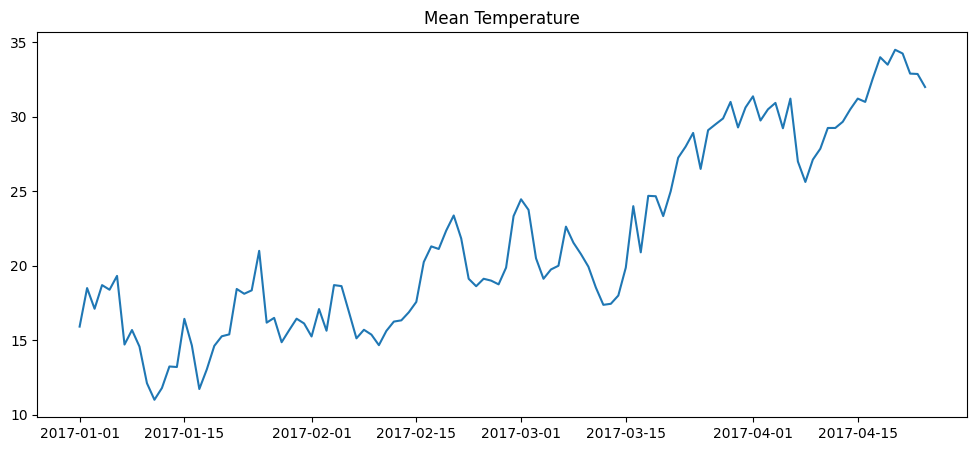
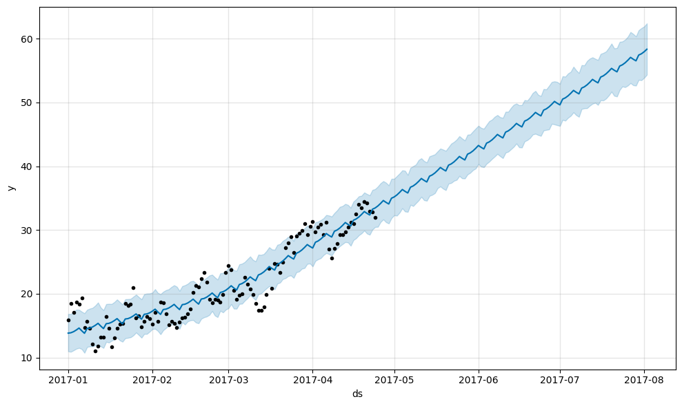

# Delhi Climate Time Series Forecasting

A time series analysis and forecasting project evaluating **ARIMA**, **SARIMA**, and **Prophet** on daily Delhi climate observations (`DailyDelhiClimateTest.csv`).

> **Dataset & Scope Notice:** `Project_11_.ipynb` was authored in **Google Colab** and loads `DailyDelhiClimateTest.csv` from `/content/drive/MyDrive/DailyDelhiClimateTest.csv` (the CSV file is not bundled in this repository). Although the notebook heading mentions *"Time Series Forecasting & Transfer Learning"*, the implemented code covers **Time Series Forecasting (Part 1)** while Part 2 consists of conceptual model-improvement notes (no Transfer Learning implementation is present).

---

## Overview

- **Dataset:** 114 daily records starting `2017-01-01` with 5 columns (`date`, `meantemp`, `humidity`, `wind_speed`, `meanpressure`).
- **Stationarity Analysis:** Augmented Dickey-Fuller (`adfuller`) test on `meantemp`:
  - `ADF Statistic`: `-1.0965`
  - `p-value`: `0.7165` → Series is **Not Stationary**
- **Train/Test Split:** First `84` days for training, final `30` days for evaluation.
- **Forecasting Models Implemented:**
  - `ARIMA(5, 1, 0)` (`statsmodels`)
  - `SARIMAX(1, 1, 1) x (1, 1, 1, 12)` (`statsmodels`)
  - `Prophet` (`prophet`) — fitted on the full series to project a 100-day horizon (`make_future_dataframe(periods=100)`).

---

## Genuine Notebook Visual Outputs

Extracted directly from saved execution outputs in `Project_11_.ipynb`:

| Daily Mean Temperature Series | Prophet 100-Day Forecast |
| :---: | :---: |
|  |  |

---

## Recorded Evaluation Results (30-Day Test Split)

| Model | MAE | RMSE |
| :--- | :---: | :---: |
| **ARIMA(5, 1, 0)** | **4.4683** | **4.9144** |
| **SARIMA(1, 1, 1)(1, 1, 1, 12)** | 5.2344 | 5.5655 |

> Note: On the saved 30-day evaluation split (`84` train / `30` test), `ARIMA(5,1,0)` achieved lower MAE and RMSE than `SARIMA(1,1,1)(1,1,1,12)`. (Cell 51 in the notebook includes a generic textbook note about SARIMA capturing seasonality, which contrasts with the measured test split result above.)

---

## Project Structure

```text
delhi-climate-time-series-forecasting/
├── Project_11_.ipynb                     # Main Colab time series notebook
├── screenshots/                          # Genuine plots extracted from notebook outputs
├── requirements.txt                      # Python & Colab dependencies
├── .gitignore
└── README.md
```

---

## Dependencies & Execution

### Google Colab (Original Environment)
The notebook installs `prophet` and `pmdarima` (`!pip install prophet pmdarima -q`) and reads `/content/drive/MyDrive/DailyDelhiClimateTest.csv`. Upload `DailyDelhiClimateTest.csv` to Google Drive and mount Drive before running.

### Local Execution
1. Clone the repository and install dependencies:
   ```bash
   git clone https://github.com/ahmadtanoli2004/delhi-climate-time-series-forecasting.git
   cd delhi-climate-time-series-forecasting
   python -m venv .venv
   # Windows: .venv\Scripts\activate
   # macOS/Linux: source .venv/bin/activate
   pip install -r requirements.txt
   ```
2. Download `DailyDelhiClimateTest.csv` (from the Daily Delhi Climate dataset) and update the `pd.read_csv(...)` path in Cell 9.
3. Launch Jupyter:
   ```bash
   jupyter notebook Project_11_.ipynb
   ```
